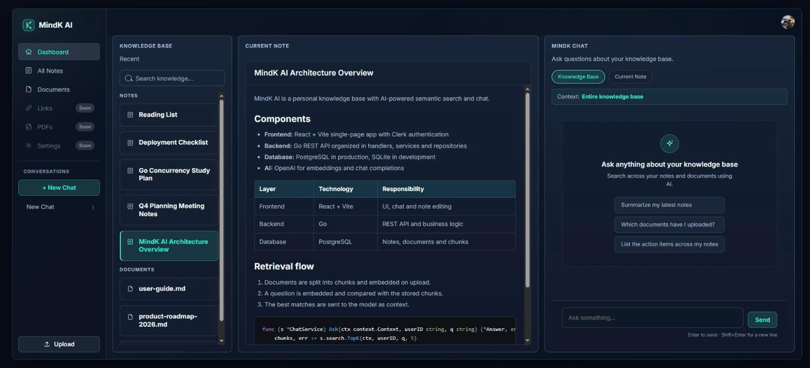
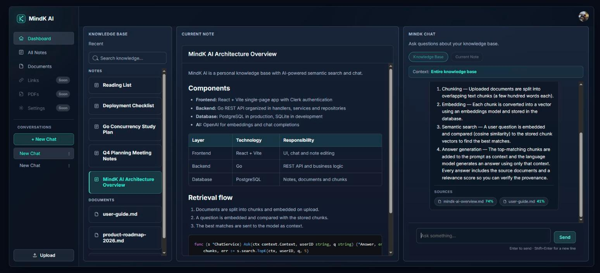
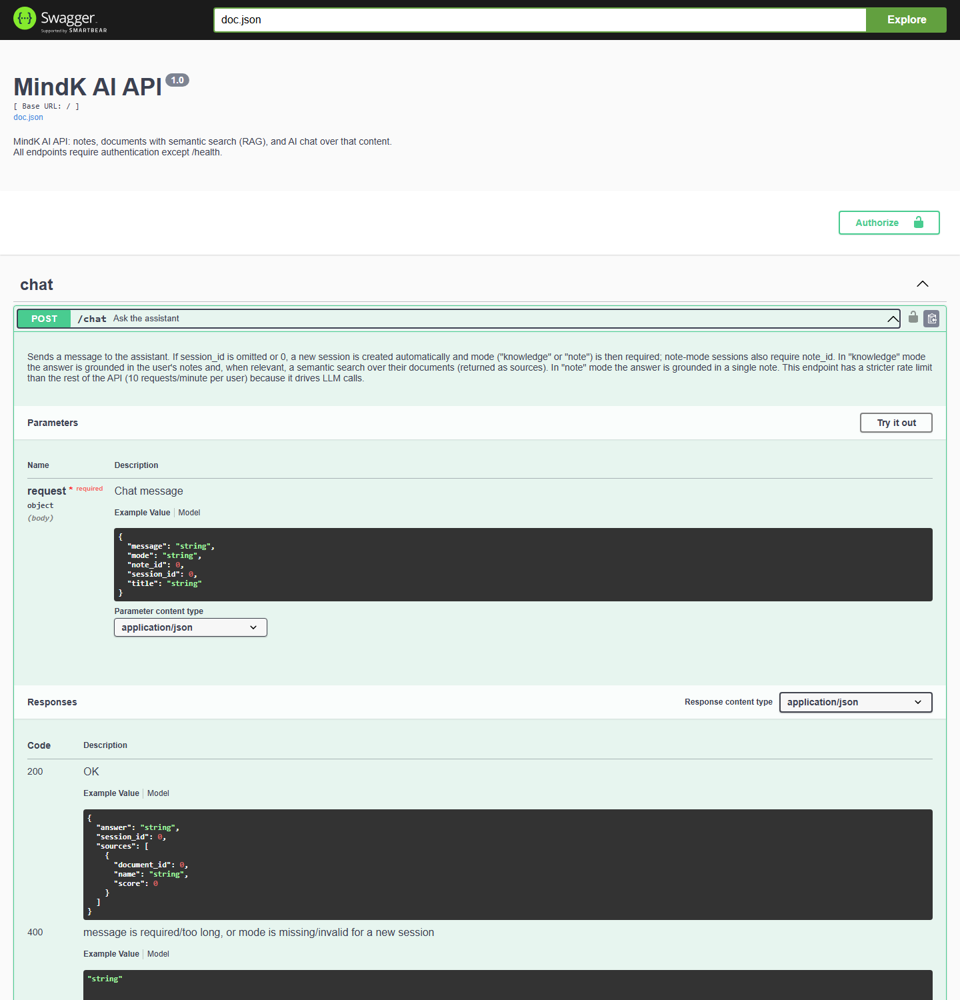
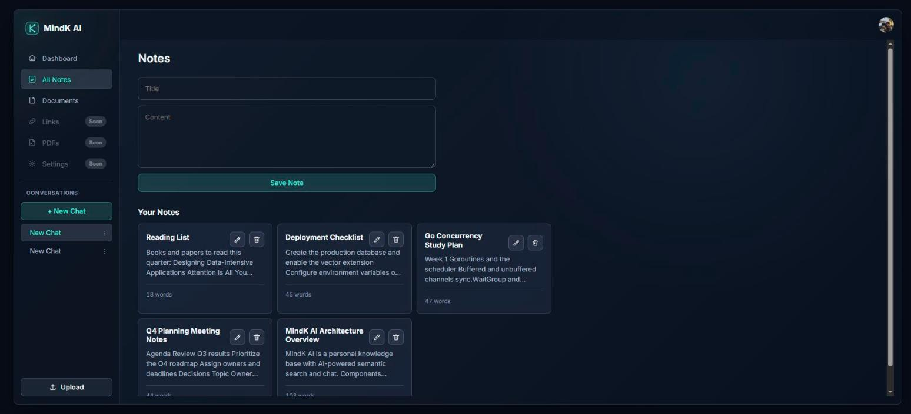
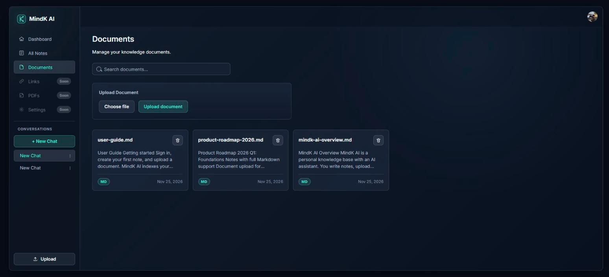
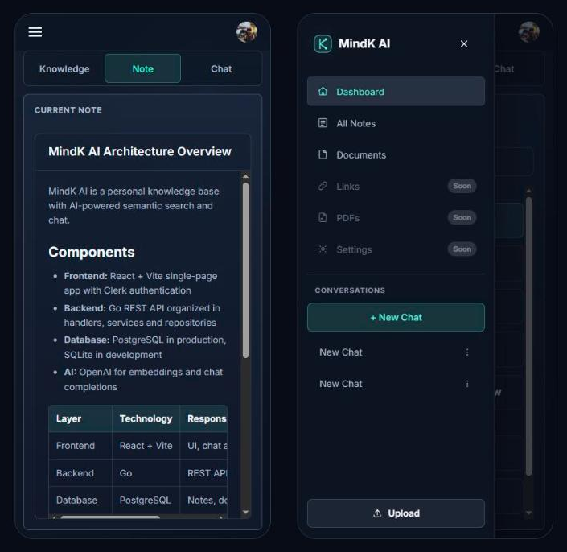

# MindK AI

[](https://github.com/pitercoding/mindk-ai/actions/workflows/ci.yml)
[](LICENSE)
[](https://mindk-ai-frontend.onrender.com/)


MindK AI is an app where you write notes, upload documents, and chat with an AI assistant that answers **using your own content** instead of guessing from general knowledge.



## What it does

- Write and edit **notes** (Markdown supported).
- Upload **documents** (PDF, Markdown or plain text, up to 10 MB).
- **Chat with the AI** about one note or about all your documents.
- Answers show the **sources** they used, with a relevance score.
- **Sign in** with Clerk. Each person only sees their own data.
- Works on phone and desktop, with toasts, loading placeholders and confirmation dialogs.

## How the chat finds answers (RAG)

When you ask a question in "knowledge base" mode:

1. Your documents were already split into small pieces and turned into numbers (embeddings) when you uploaded them.
2. The question is turned into numbers too, and the app finds the pieces that are most similar to it.
3. Those pieces are sent to the AI together with your question, so it answers from your documents.



The full technical flow is in [Architecture](docs/ARCHITECTURE.md).

## Try it online

The app is live, no installation needed: [mindk-ai-frontend.onrender.com](https://mindk-ai-frontend.onrender.com/)

1. **Open the link and wait.** It runs on free hosting, so the first visit after a while of inactivity can take up to about a minute to wake up. If you see an error, wait a few seconds and refresh.
2. **Create an account** (or sign in) on the sign-in screen.
3. **Add a note.** Go to **Notes**, type a title and some content, and click **Save Note**.
4. **Upload a document.** Go to **Documents**, choose a `.md`, `.txt` or `.pdf` file, and upload it. Wait for the "uploaded successfully" message.
5. **Ask a question.** Go back to the **Dashboard**, pick the knowledge base or a note, and ask something about what you added. The answer appears with the sources below it.
6. **Check the extras.** Try the search box in **Documents**, delete something (a confirmation appears first), and resize the window to see the mobile layout.

If it does not work, see [Quick checks](#quick-checks-if-something-fails).

## Technologies

| Area | What is used |
| --- | --- |
| Frontend | React 19, TypeScript, Vite, React Router, `react-markdown` |
| Backend | Go (standard library `net/http`, no web framework) |
| Database | SQLite in development, PostgreSQL in production |
| AI | OpenAI (chat and embeddings) with a custom RAG pipeline |
| Login | Clerk |
| Tests | Go `testing` + testify, Vitest + Testing Library |
| CI | GitHub Actions, Dependabot |
| Hosting | Render (backend and frontend), Neon (PostgreSQL), Docker |

## Run it on your computer

You need [Go](https://go.dev/), [Node.js](https://nodejs.org/) 22 or newer, and your own [OpenAI](https://platform.openai.com/) and [Clerk](https://clerk.com/) keys. No keys are provided in this repository.

### 1. Download

```bash
git clone https://github.com/pitercoding/mindk-ai.git
cd mindk-ai
```

### 2. Set up the settings files

```bash
cp backend/.env.example backend/.env
cp frontend/.env.example frontend/.env
```

Then open both files and fill in your keys.

**Backend (`backend/.env`)**

| Variable | Required | Notes |
| --- | --- | --- |
| `OPENAI_API_KEY` | yes | your OpenAI key |
| `CLERK_SECRET_KEY` | yes | your Clerk secret key |
| `APP_ENV` | no | `development` (default) or `production` |
| `PORT` | no | default `8080` |
| `FRONTEND_ORIGIN` | no in development | default `http://localhost:5173`; required in production |
| `DATABASE_PATH` | no | SQLite file, development only (default `./data/mindk.db`) |
| `DATABASE_URL` | production only | PostgreSQL connection string |

**Frontend (`frontend/.env`)**

| Variable | Required | Notes |
| --- | --- | --- |
| `VITE_CLERK_PUBLISHABLE_KEY` | yes | your Clerk publishable key (safe to expose) |
| `VITE_API_URL` | no | default `http://localhost:8080` |

### 3. Start the backend

```bash
cd backend
go run ./cmd/api
```

It runs on `http://localhost:8080`. In development it creates its own SQLite database and tables automatically.

### 4. Start the frontend

```bash
cd frontend
npm install
npm run dev
```

Open `http://localhost:5173`.

### Or use Docker

`docker-compose.yml` starts the backend together with a PostgreSQL database (production mode):

```bash
OPENAI_API_KEY=your_key CLERK_SECRET_KEY=your_key docker compose up
```

The frontend is not included. Start it with `npm run dev` as shown above.

## Tests and CI

Run the tests locally:

```bash
# Backend
cd backend
go test ./...

# Frontend
cd frontend
npm test
```

- **Backend:** unit tests next to the code, plus integration tests that run the whole API (login, rate limits, user isolation) on a real SQLite database. The AI is replaced by a fake, so tests never call OpenAI.
- **Frontend:** Vitest + Testing Library tests for utilities, the API client, components and the Notes and Documents pages.
- **PostgreSQL tests:** an extra suite runs only when `POSTGRES_TEST_URL` is set, and is skipped otherwise.

**Automatic checks (GitHub Actions).** Every pull request and every push to `main` runs [`ci.yml`](.github/workflows/ci.yml):

| Check | What it does |
| --- | --- |
| Backend | `go vet` and `go test -race` |
| Backend (PostgreSQL) | integration tests against a real PostgreSQL 18 |
| Frontend | lint, tests and production build |
| Docker | builds the backend image |

[Dependabot](.github/dependabot.yml) opens weekly pull requests to keep npm, Go, Docker and GitHub Actions dependencies up to date.

## Deployment

| Part | Host | Notes |
| --- | --- | --- |
| Backend (Go API) | Render, Docker web service | health check at `/health` |
| Frontend (React) | Render, static site | built with Vite |
| Database | Neon, serverless PostgreSQL | free tier |

In production the backend needs `APP_ENV=production`, `DATABASE_URL` and `FRONTEND_ORIGIN`. Tables are created automatically on startup, so an empty database is enough.

Notes about the free tiers:

- Use Neon's **direct** connection string (the host without `-pooler`). The migration tool needs database locks that do not work reliably behind a pooler.
- Idle services go to sleep, so the first request can take a few seconds (database) to about a minute (backend).
- Never commit the real `DATABASE_URL`. Set it only in the hosting dashboard.

### Quick checks if something fails

- **The page loads but nothing works for a while:** the backend is probably waking up. Wait about a minute and refresh.
- **Chat errors:** the OpenAI key may have no credit, or you sent too many messages. Chat allows 10 messages per minute per user, and everything else 60 requests per minute.
- **Upload is rejected:** only `.pdf`, `.md` and `.txt` files up to 10 MB are accepted.

## API documentation

The backend is a REST API. Interactive Swagger docs are available at `/swagger/` when running locally in development mode (they are turned off in production on purpose).



## Screenshots

**Notes:** Markdown notes with clean previews.



**Documents:** uploaded files with type and date.



**Mobile:** the dashboard becomes Knowledge / Note / Chat tabs and the sidebar becomes a drawer.



## Project structure

```text
mindk-ai/
├── .github/
│   ├── workflows/ci.yml        # automatic checks
│   └── dependabot.yml          # weekly dependency updates
├── backend/
│   ├── cmd/api/                # entry point
│   ├── internal/
│   │   ├── handlers/           # HTTP endpoints
│   │   ├── services/           # business logic (notes, chat, documents, RAG)
│   │   ├── repository/         # database access
│   │   ├── llm/                # OpenAI client
│   │   ├── middleware/         # login, rate limit, security headers, logs
│   │   ├── migrations/         # SQLite and PostgreSQL tables
│   │   ├── integration/        # full-API tests
│   │   └── testutil/           # test server and helpers
│   ├── docs/                   # generated Swagger files
│   └── Dockerfile
├── frontend/
│   └── src/
│       ├── pages/              # Dashboard, Notes, Documents, Auth, NotFound
│       ├── components/         # screen parts, grouped by feature
│       ├── context/            # chat sessions, selection, toasts
│       ├── services/           # calls to the API
│       └── utils/              # text helpers
│                               # tests (*.test.ts[x]) sit next to their code
├── docs/
│   ├── ARCHITECTURE.md
│   └── screenshots/
├── docker-compose.yml
└── README.md
```

## Architecture

A React app talks to a layered Go API (handlers, then services, then repositories). Data lives in SQLite (development) or PostgreSQL (production), and a RAG pipeline powers the document chat through OpenAI. Details on the pipeline, login, data ownership and security are in [docs/ARCHITECTURE.md](docs/ARCHITECTURE.md).

## Project status

MindK AI is a portfolio project with automated tests and CI, deployed on Render with a Neon database. Because it runs on free tiers, the first request after inactivity can be slow.

## Next improvements

- Keep the cited sources in the chat history (today they show only for live answers) and make them open the document.
- Add a vector index (for example pgvector) if the number of documents per user grows a lot.
- Split the frontend bundle (it is a single file above 500 kB) with route-based code splitting.
- More frontend tests (dashboard and chat) and a test-coverage report in CI.

## Highlights

- A real RAG pipeline (chunking, embeddings, semantic search, cited sources), not just a chat wrapper.
- Multi-user data isolation enforced in the database and verified by integration tests.
- Layered backend where the AI client is injected, so everything is testable without OpenAI.
- A responsive, accessible interface built on a small hand-written design system.
- Automated tests and a CI pipeline on every pull request.
- Swagger docs generated from the code.

## License

MIT. See [LICENSE](LICENSE).
